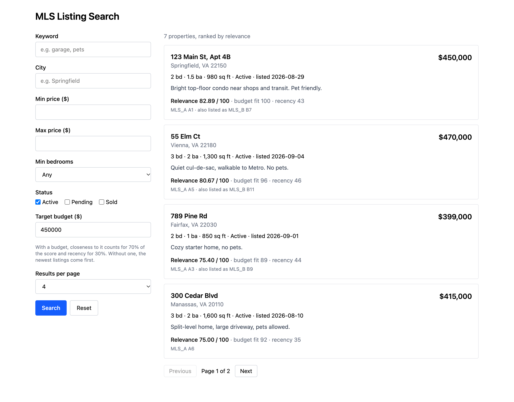
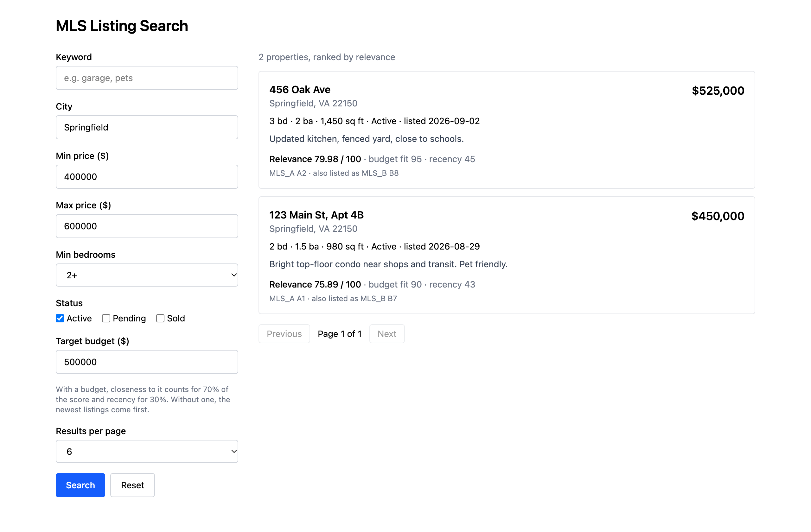
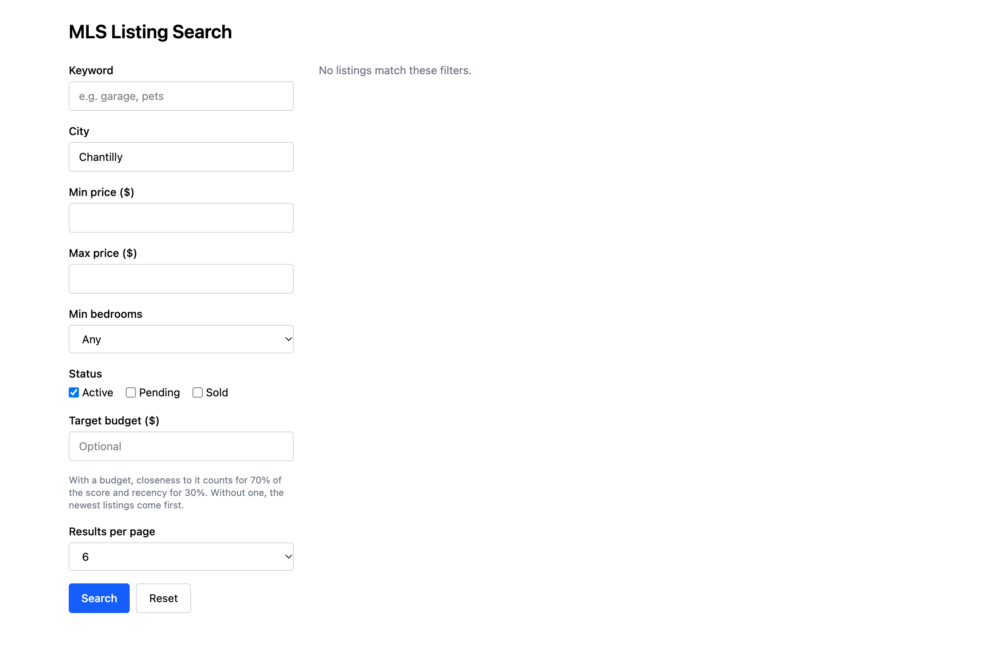
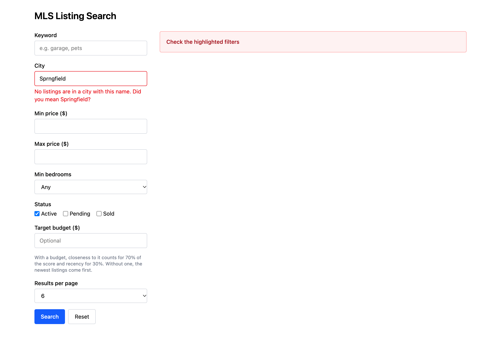
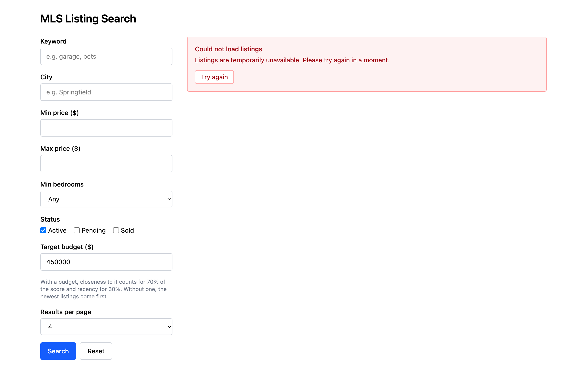

# MLS Listing Search

A full-stack search over property listings from two MLS feeds. It filters, ranks by budget fit and
recency, merges the same house reported by both feeds, and pages through the results.

| | |
|---|---|
| Backend | Python 3.11+, FastAPI, Pydantic v2 |
| Frontend | React 19, strict TypeScript, Zod, Tailwind |
| Checks | pytest, Ruff, mypy `--strict`; Vitest + Testing Library, ESLint `strictTypeChecked` |



## Contents

1. [Quick start](#quick-start)
2. [Screenshots](#screenshots)
3. [How the brief is covered](#how-the-brief-is-covered)
4. [Scoring](#scoring)
5. [How a search runs](#how-a-search-runs)
6. [Decisions and trade-offs](#decisions-and-trade-offs)
7. [Invalid input and failures](#invalid-input-and-failures)
8. [API](#api)
9. [Tests](#tests)
10. [Limitations and next steps](#limitations-and-next-steps)

## Quick start

You need Python 3.11+, [uv](https://docs.astral.sh/uv/), and Node.js 22.22+, 24.15+ or 26+ (the
versions jsdom supports).

```bash
make install
```

```bash
make dev
```

`make dev` starts both servers in one terminal, and Ctrl+C stops both. Open
<http://127.0.0.1:5173> for the UI and <http://127.0.0.1:8000/docs> for the interactive API docs.

Without make, run each server in its own terminal:

```bash
cd backend && uv sync && uv run uvicorn app.main:app --reload --port 8000
```

```bash
cd frontend && npm install && npm run dev
```

Without uv, create a virtualenv in `backend/`, run `pip install -r requirements-dev.txt`, and start
the same `uvicorn` command.

## Screenshots

The search lives in the URL, so each of these opens directly from its query string.

| Several filters at once | No results | A rejected filter |
|---|---|---|
|  |  |  |
| `?city=Springfield&minPrice=400000&maxPrice=600000&minBedrooms=2&targetBudget=500000`: two houses, each reported by both feeds and shown once | `?city=Chantilly`: a known city whose only listing is pending | `?city=Sprngfield`: the message appears under the field, with the city the typo most likely means |

## How the brief is covered

Backend paths are under `backend/app/listings/`, frontend paths under `frontend/src/features/listings/`.

| Requirement | Implemented in | Proved by |
|---|---|---|
| Filter by `minPrice`, `maxPrice`, `minBedrooms`, `city`, keyword | `domain/filters.py` | `test_repository_contract.py` |
| Rank by `targetBudget` and recency | `domain/ranking.py` | `test_full_ranking_for_a_fixed_budget_and_date` |
| Pagination the user can see and move through | `application/search.py`, `ui/Pagination.tsx` | `test_pages_in_order_rebuild_the_full_ranking` |
| Address, price, bedrooms and relevance on each result | `ui/ListingCard.tsx` | `Results.test.tsx` |
| Loading, no-results and error states | `ui/Results.tsx`, `hooks/useListingSearch.ts` | `Results.test.tsx`, `useListingSearch.test.ts` |
| Clear errors for `minPrice > maxPrice`, `pageSize ≤ 0`, an unknown city | `http/dto.py`, `application/search.py` | `test_invalid_parameter_is_422_naming_the_field` |
| Edge cases: no matches, tied scores, pagination boundaries | | `test_valid_filters_that_match_nothing_*`, `test_tied_scores_*`, `test_page_past_the_end_*`, `test_last_page_can_be_partial` |

## Scoring

```text
recency   = 100 × exp(−ageDays / 90)              ageDays = today (UTC) − listedDate, never below 0
budgetFit = 100 × max(0, 1 − |price − targetBudget| / targetBudget)
relevance = 0.7 × budgetFit + 0.3 × recency       recency alone when there is no target budget
```

All three are on a 0–100 scale and the API returns each of them, so the UI can show why a listing
ranks where it does.

- **Budget carries 70%.** Someone who types a budget cares about price most. Recency separates
  houses at a similar price: a listing that went live last week is more likely to still be available.
- **Budget fit is relative and linear.** Measured against the budget, it means the same in a $200k
  search and a $2M one. 10% over and 10% under both score 90; 100% off scores 0 and it never goes
  below.
- **Recency decays exponentially.** It loses about two thirds in 90 days, so old listings fade
  instead of vanishing at a cutoff. A `listedDate` in the future counts as today.

**Worked example.** `targetBudget=450000`, today = 2026-11-12:

| Listing | Price | Age | Budget fit | Recency | Relevance |
|---|---|---|---|---|---|
| A1 | $450,000 | 75 days | 100 × (1 − 0 / 450000) = **100.00** | 100 × e^(−75/90) = **43.46** | 0.7 × 100 + 0.3 × 43.46 = **83.04** |
| A5 | $470,000 | 69 days | 100 × (1 − 20000 / 450000) = **95.56** | 100 × e^(−69/90) = **46.46** | 0.7 × 95.56 + 0.3 × 46.46 = **80.83** |

A5 is six days newer, but A1 is exactly on budget, and budget weighs more.
`test_full_ranking_for_a_fixed_budget_and_date` pins this order for all seven active houses, so a
change to the formula fails a test instead of silently reordering results.

**Ties.** Scores are rounded to two decimals *before* sorting, so two listings that show the same
score are tied instead of being ordered by a difference nobody can see. Ties go to the newer
listing, then to `source`, then to `id`. The order is total, so the same request always returns the
same order, and pages never overlap or skip a house.

**What the formula leaves out.** Going over budget costs the same as coming in under it; in a real
product I'd ask whether over should cost more. The weights (70/30, 90 days) are judgement calls,
not fitted to data. Bedrooms and keyword hits filter results but don't affect the score.

## How a search runs

```text
backend/app/main.py                    composition root: picks the repository, the ranking and the clock
backend/app/listings/domain/           listing model, filters, ranking, duplicate key, city suggestions; no FastAPI
backend/app/listings/application/      the search use case and the ListingRepository and Ranking interfaces
backend/app/listings/infrastructure/   the JSON file repository
backend/app/listings/http/             query and response models, the route, the error format
frontend/src/features/listings/        model (filters, URL, schemas), api, hooks, ui
```

N is the number of listings, m the number that match, M the number of houses among them, and
k = page × pageSize.

| Step | Code | Cost |
|---|---|---|
| Validate every parameter; one 422 lists all problems | `SearchQueryDTO` | constant |
| Find every match | `ListingRepository.find` | O(N · L) with a keyword (L = description length), O(N) without |
| Score each match | `Ranking.score` | O(m) |
| Merge each house's records, keep the best-ranked one | `_merge_duplicates` | O(m), a dictionary keyed by house |
| Order houses only up to the end of the requested page | `heapq.nsmallest(k, …)` | O(M log k), instead of O(M log M) for sorting them all |
| On an empty result with a city: unknown city? closest known one? | `_ensure_city_exists` | O(N), only on that path |

A search costs O(N · L + m + M log k). At twelve records that is microseconds; the table shows where
it would break first: the keyword scan and the full scan, which an inverted index and a database
replace. Taking the top k after merging gives the same order as sorting everything, because a house
is shown by its best record either way and houses are ordered by that record.
`test_pages_in_order_rebuild_the_full_ranking` checks this for page sizes 1 to 9.

## Decisions and trade-offs

- **Merge the same house across feeds** by state, city and normalized address (lowercased,
  punctuation dropped, `St` → `street`, `Apt`/`Suite`/`#` → `unit`); ZIP is ignored. The data has
  four houses in both feeds, spelled differently (`123 Main St, Apt 4B` vs `123 Main Street, Unit
  4B`), one with a different ZIP. Shown twice, they would waste slots and inflate `total`.
  *Cost:* the key is exact, so a misspelled street or city slips through.
- **Score first, merge, then page.** The record shown for a house is the one that best fits this
  search, the other feeds' records are listed under it, and `total` counts houses. *Cost:* the
  repository returns every match rather than one page; a database would merge at ingest instead, so
  it can page in SQL.
- **City is a trimmed, case-insensitive substring**, so `spring` finds Springfield and stray spaces
  from a feed don't matter. *Cost:* `field` matches Springfield too, and a substring can't use a
  database index.
- **A city no listing has is a 422**, with "Did you mean …?" when a known city is close (`difflib`,
  cutoff 0.75: typos of the sample cities score 0.91 and up, unrelated names like "Atlantis" under
  0.5). The brief lists a city with no matches as invalid input, and an empty page would hide the
  typo. The search is never rerun with the guess, because a wrong guess returns wrong data that
  looks right. *Cost:* whether a city is "known" depends on the data.
- **Keyword: each word must start a word in the description**, as written or with regular plurals
  folded to the singular on both sides. `pet` finds "pets" but not "carpet", `movie` finds
  "movies", `pets` finds "Pet friendly", `garages` finds "2-car garage". *Cost:* plain text matching,
  so `pets` also finds "No pets"; without a dictionary, `movies` and `buses` fold to the wrong stem
  and miss "movie" and "bus".
- **`status` defaults to `active`.** Not in the brief: a buyer wants what's on the market, and the
  data has a pending listing. Pending and sold are a checkbox away.
- **Validation lives in one place**, the query model in `http/dto.py`. The form repeats only the
  checks a person can trip over (a negative price, min above max), so the common mistakes get an
  answer without a round trip, and the API's errors appear under the matching field. *Cost:* those
  few checks exist twice.
- **Amounts are text inputs with a numeric keyboard**, not `type="number"`: a number input reports
  a typo like `500-000` as empty, so the search would quietly run without it.
- **The applied search lives in the URL; the form edits a draft.** Reload, Back/Forward and shared
  links work, nothing fires while typing, and a newer search aborts the one in flight.
- **Storage and scoring sit behind interfaces** (`ListingRepository`, `Ranking` in
  `application/ports.py`). A database or a new formula is one class and one line in `app/main.py`,
  and any storage must pass the same contract tests. Tie rules stay in the search, so every formula
  pages the same way.
- **The JSON file is read and validated on the first search, then kept in memory.** If it can't be
  read, searches get a 503 and the next one tries again, so the app stays up and recovers on its
  own once the file is fixed. A database behind the same interface fails the same way. *Cost:* one
  bad record makes the whole file unavailable.
- **Every failure tells the user what to do next.** A rejected filter is shown on its field. An
  outage, a backend that is down or restarting, or an answer that takes over 10 seconds says to try
  again in a moment, with a button; a lost connection says to check it. Nobody is left with an
  endless spinner or a technical error.

## Invalid input and failures

Every failure, whatever its status, has the same body, and a 422 lists every bad parameter at once:

```json
{
  "code": "VALIDATION_ERROR",
  "message": "Invalid search parameters",
  "details": [{ "field": "maxPrice", "message": "Maximum price must be at least the minimum price." }]
}
```

| Request | Result | Why |
|---|---|---|
| `minPrice=700000&maxPrice=200000` | 422 on `maxPrice` | No price can satisfy both. |
| `pageSize=0`, `pageSize=101`, `page=0` | 422 on that parameter | |
| `minPrice=abc`, `minPrice=inf`, `targetBudget=NaN` | 422 on that parameter | Rejected, never coerced. |
| `minprice=5` | 422 on `minprice` | A typo in a name would otherwise be ignored without anyone noticing. |
| `city=Atlantis` | 422 on `city` | No listing of any status is there: almost always a typo. |
| `city=Sprngfield` | 422 on `city`, "Did you mean Springfield?" | The user sees how to fix it. |
| `city=Chantilly` | 200, empty, `total: 0` | A known city with no active listing: a valid question whose answer is "nothing". |
| `page=99` | 200, empty, totals kept | The UI offers to go back to the first page. |
| Unknown path or method | 404 or 405 | Same body; a 405 keeps its `Allow` header. |
| The listings can't be read: the file is missing or broken (later, a database that is down) | 503 `SERVICE_UNAVAILABLE`, "try again in a moment" | The app keeps running and logs the cause. Once the data is back, the next search works, with no restart. |
| Unexpected failure | 500 `INTERNAL_ERROR` | A fixed message, no internals. |

**Two audiences.** Every message in a response is written for the person using the search: Pydantic's
wording such as "unable to parse string as a number" is replaced with "Enter a number, for example
450000.", and a failure never shows a status code or a stack trace. What a developer needs stays
in the response (`code`, and the parameter name in `field`) and in the server log, one line per
failed search with what failed and where (path shortened here):

```text
Listings are unavailable: Cannot read backend/data/sample_listings.json: [Errno 2] No such file or directory
```

When the data file is missing, the search page says this, and it works again as soon as the file
is back:



## API

### `GET /api/listings`

| Parameter | Type | Default | Rules |
|---|---|---|---|
| `minPrice`, `maxPrice` | number | none | ≥ 0, finite; `maxPrice` ≥ `minPrice` |
| `minBedrooms` | integer | none | ≥ 0 |
| `city` | string | none | ≤ 120 chars; trimmed, case-insensitive substring |
| `keyword` | string | none | ≤ 250 chars; each word must start a word in the description |
| `targetBudget` | number | none | > 0, finite; turns on budget scoring |
| `status` | `active`, `pending`, `sold` | `active` | repeatable, up to three times |
| `page` | integer | 1 | ≥ 1 |
| `pageSize` | integer | 6 | 1 to 100 |

All filters must match, every bound is inclusive, and unknown parameters are rejected.

For `targetBudget=450000&pageSize=1`, with today fixed at 2026-11-12:

```json
{
  "items": [
    {
      "id": "A1", "source": "MLS_A", "address": "123 Main St, Apt 4B",
      "city": "Springfield", "state": "VA", "zip": "22150",
      "price": 450000.0, "bedrooms": 2, "bathrooms": 1.5, "sqft": 980,
      "latitude": 38.7893, "longitude": -77.1873,
      "listedDate": "2026-08-29", "status": "active",
      "description": "Bright top-floor condo near shops and transit. Pet friendly.",
      "relevanceScore": 83.04, "budgetScore": 100.0, "recencyScore": 43.46,
      "duplicates": [{ "source": "MLS_B", "id": "B7" }]
    }
  ],
  "pagination": { "page": 1, "pageSize": 1, "total": 7, "totalPages": 7 }
}
```

Without a target budget, `budgetScore` is `null` and `relevanceScore` equals `recencyScore`.
`duplicates` lists the same house as reported by the other feeds, and `total` counts houses, not
records.

## Tests

```bash
make check
```

This runs pytest, Ruff and mypy on the backend, then Vitest, ESLint and the production build on the
frontend. Most of the logic, and so most of the testing, is on the backend.

| Suite | What it pins down |
|---|---|
| `backend/tests/test_search.py` | Scoring, every tie rule, duplicate merging, pagination edges, broken data files, the full ranking for a fixed date. |
| `backend/tests/test_repository_contract.py` | Which listings each filter matches, including all 64 combinations of the six filters. The expected sets were read off the data by hand, so they don't depend on the code under test. |
| `backend/tests/test_api.py` | Response shape, exact scores against a fixed date, every kind of bad parameter, the error body for 404, 405, 422, 500 and 503, recovery once the data file is back. |
| `frontend/tests/filters.test.ts` | The form model: validation, the URL round trip, sorting API errors onto form fields. |
| `frontend/tests/useListingSearch.test.ts` | A replaced search is aborted and its late answer never reaches the screen; retry; a search gives up after 10 seconds; one message per kind of failure. |
| `frontend/tests/SearchForm.test.tsx`, `Results.test.tsx` | Every state the user can see: typos reported, API errors on their fields, loading, no results, a page past the end, paging. |
| `frontend/tests/ListingExplorer.test.tsx` | The whole page: search, paging, the URL, an unknown city highlighted until fixed, Back restoring the previous search. |

Backend tests inject a fixed date, so recency scores are exact. Frontend tests run in jsdom against
a fake `fetch`.

## Limitations and next steps

- **Keyword search** can't tell that "no pets" means the opposite. It folds only regular plurals,
  some of them to the wrong stem (`movies` doesn't find "movie"), and no verb forms (`allowed`
  doesn't find "allows"). Next: a stemmer, or a search engine's language analyzer.
- **Duplicates** with a misspelled street or city aren't merged. Next: also compare coordinates,
  bucketing them into grid cells so only neighbours are compared.
- **Scale.** Every search scans all listings in memory. For millions of rows: merge duplicates when
  the feeds are loaded, then filter, score and page in SQL, with indexes on `(status, price)` and
  `(status, bedrooms)` and a full-text index on the description, or move search to a search engine.
- **End-to-end test.** Nothing runs the UI against the real backend yet. Next: one Playwright test
  of the main flow.
- **Shared types.** The Zod schemas mirror the backend models by hand. Next: generate them from the
  OpenAPI schema.
- **Production.** `npm run build` produces static files, but nothing serves them on the same origin
  as the API; locally the Vite proxy does that. A public deploy would also need HTTPS, rate limiting
  at the proxy, and `/docs` turned off.
